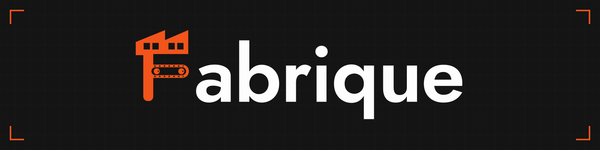
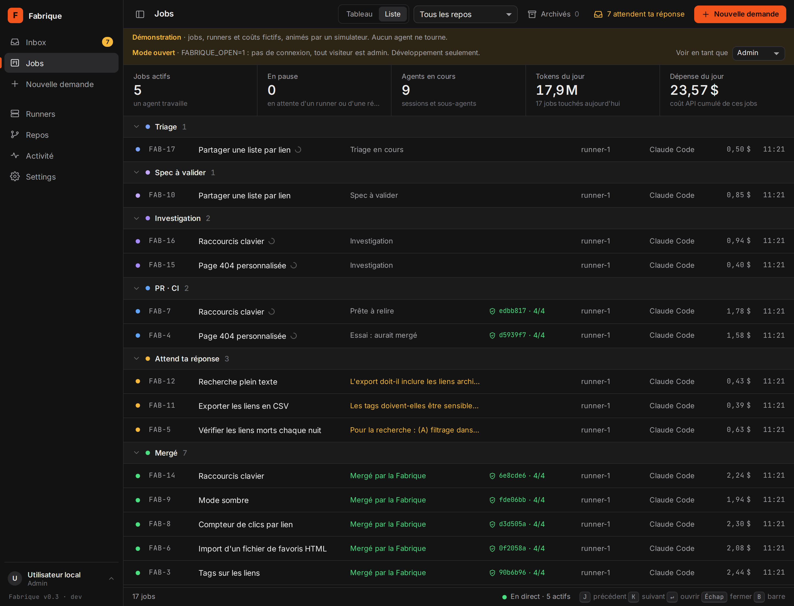
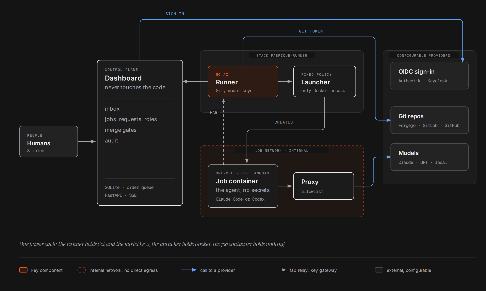
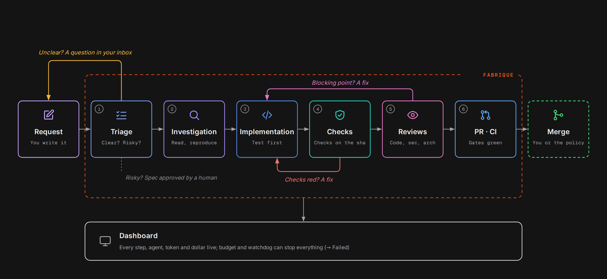
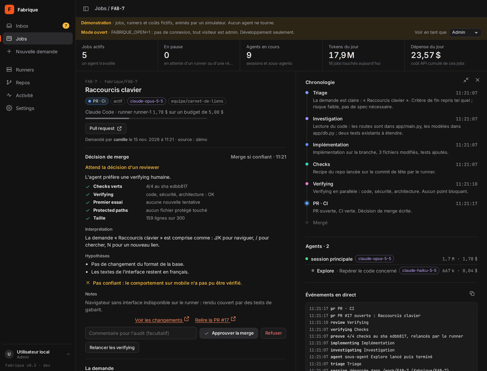
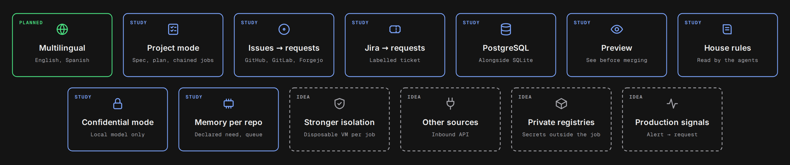

# Fabrique

[English](README.md) · **Français**

**Une usine logicielle agentique pensée pour l'exploitation.** On dépose une demande ; un agent de code la trie, enquête,
implémente et propose une *pull request* ; un runner sans IA rejoue les checks, fait relire le changement et applique
des barrières ; un humain répond aux questions et décide des merges.

La Fabrique ne dépend d'aucun provider : Forgejo, GitLab ou GitHub pour le code ; n'importe quel provider OIDC
(Authentik, Keycloak…) pour la connexion ; Claude Code ou Codex comme agent ; un modèle Anthropic, OpenAI ou local
(llama.cpp, vLLM).



## Pourquoi

Faire écrire du code à un agent est facile. Le laisser travailler **sans surveillance** sur de vrais repos ne l'est pas :
il faut savoir ce qu'il a le droit de toucher, prouver que ses tests passent vraiment, borner ce qu'il dépense, et garder
la décision de merge entre les mains de quelqu'un. La Fabrique traite ces questions comme des questions d'architecture
et d'infrastructure, pas comme des consignes données au modèle.

- **L'agent n'a aucun secret.** Il tourne dans un conteneur jetable, sans token Git ni clé de modèle, sur un réseau
  interne dont la seule sortie est un proxy en liste blanche.
- **Les preuves ne viennent pas de l'agent.** Le runner rejoue lui-même la recipe du repo (installation, tests) sur le
  commit exact de la PR, puis fait relire le diff par des vérificateurs en lecture seule.
- **Le merge est une décision.** Des barrières vérifiables (checks verts, vérification, protected paths, taille,
  premier essai, avis de l'agent) alimentent une politique par repo : jamais seule, à l'essai, ou seule si tout tient.
- **Tout est tracé.** Chaque étape, coût, question, décision et merge est dans le journal d'audit.

## Comment ça marche



| Pièce | Rôle | Ce qu'elle détient |
|---|---|---|
| **Dashboard** (`app/`) | Plan de contrôle : demandes, inbox, barrières, settings, audit. Ne touche jamais au code. | La base, les décisions |
| **Runner** (`runner/`) | Programme sans IA : prend les commandes du dashboard, prépare le workspace, lance l'agent, rejoue les checks, pousse, ouvre la PR, merge. | Tokens Git, clés des modèles (le temps d'un job) |
| **Launcher** (`lanceur/`) | Crée un conteneur jetable par job, avec une politique figée. | Le seul accès à Docker |
| **Conteneur du job** | Là où tournent l'agent et le code du repo. | Rien |
| **Proxy** (`proxy/`) | Seule sortie réseau des jobs, en liste blanche. | — |

Le chemin d'une demande, de son repo au merge :



## Ce que fait la Fabrique

- **Demandes et suivi** : formulaire de demande, tableau ou liste des jobs, chronologie, événements en direct, coûts et
  tokens par job, inbox (questions de l'agent, PR à relire, échecs, repos à créer).
- **Études** : une demande de type « Étude » fait lire le repo à l'agent, qui rend un rapport (analyse, chiffrage,
  options) sans rien modifier — ni branche, ni PR ; le rapport se télécharge en PDF ou en Markdown et peut ensuite
  devenir une demande de code.
- **Onboarding d'un repo** : un agent lit le repo et écrit sa *recipe* (`.fabrique/setup.json` : image, installation,
  checks) ; le runner la rejoue dans un conteneur neuf ; un humain le merge.
- **Vérification** : code et sécurité toujours, architecture et infrastructure selon les fichiers touchés. Un point
  bloquant doit venir avec une preuve que le runner rejoue.
- **Diff sur place** : le reviewer lit le diff du commit vérifié dans le job lui-même, fichier par fichier, avec les
  chemins protégés signalés. C'est le runner qui l'envoie ; le dashboard ne touche toujours pas au code.
- **Contrôle de sécurité à l'écriture** : à chaque fichier écrit par l'agent, recherche de secrets en dur (Betterleaks)
  et de paquets introuvables ou tout juste publiés (nom inventé par le modèle). L'agent corrige aussitôt ; un rapport
  sur tout le job s'ajoute aux preuves, à titre d'information.
- **Politiques de merge par repo**, protected paths, taille maximale, budget par job et par jour, watchdog.
- **Création de repos** sur validation humaine, dans l'organisation choisie pour chaque provider Git.
- **Rôles** : requester, reviewer, admin ; connexion OIDC.
- **Notifications** : webhook signé, Microsoft Teams, Jira, e-mail (SMTP).
- **Plusieurs runners**, avec tags, et des images de job par langage (Python, Node.js, Go, Java).



## Démarrer

### Démarrage rapide

Télécharge le fichier compose, puis lance-le : les images sont tirées de `ghcr.io/lepikouze` (étiquette `latest`).

```sh
curl -fsSLO https://raw.githubusercontent.com/lepikouze/fabrique/main/deploy/compose.prod.yaml
docker compose -f compose.prod.yaml up -d
docker compose -f compose.prod.yaml logs dashboard | grep "code d'installation"
```

Ouvre `http://<adresse-de-l-hôte>:8080`, saisis le **code d'installation** affiché dans les journaux, puis crée le compte
administrateur. La page **Setup** guide la suite, entièrement dans l'interface : un modèle, un provider Git, un premier
repo. Le runner intégré s'enregistre seul.

Aucune variable n'est obligatoire. En production, place le port 8080 derrière un proxy inverse avec TLS et crée un
fichier `.env` à côté du compose avec l'adresse publique et les deux secrets :

```sh
cat > .env <<EOF
PUBLIC_URL=https://fabrique.exemple.org
SESSION_SECRET=$(openssl rand -hex 32)
FABRIQUE_SECRET_KEY=$(openssl rand -hex 32)
EOF
```

Les workspaces des jobs vivent dans un dossier de l'hôte, `/opt/fabrique/travail` par défaut : Docker le crée au
premier démarrage, il n'y a rien à préparer. Pour le placer ailleurs (un disque plus grand, par exemple), ajoute
`FABRIQUE_WORK_DIR=/chemin/de/ton/choix` dans le fichier `.env`.

`SESSION_SECRET` signe les sessions. `FABRIQUE_SECRET_KEY` chiffre les clés des modèles et les tokens Git enregistrés
dans le dashboard : garde-la en lieu sûr, car sans elle ces secrets sont illisibles et à ressaisir. Sans ce fichier, les
deux sont générés au premier démarrage et gardés avec les données.

### Derrière Traefik

[`deploy/compose.traefik.yaml`](deploy/compose.traefik.yaml) ne publie aucun port : seul Traefik atteint le dashboard.

```sh
curl -fsSLO https://raw.githubusercontent.com/lepikouze/fabrique/main/deploy/compose.traefik.yaml
cat > .env <<EOF
FABRIQUE_HOST=fabrique.exemple.org
TRAEFIK_NETWORK=traefik
TRAEFIK_CERTRESOLVER=letsencrypt
SESSION_SECRET=$(openssl rand -hex 32)
FABRIQUE_SECRET_KEY=$(openssl rand -hex 32)
EOF
docker compose -f compose.traefik.yaml up -d
docker compose -f compose.traefik.yaml logs dashboard | grep "code d'installation"
```

`FABRIQUE_HOST` est le nom de domaine du dashboard, `TRAEFIK_NETWORK` le réseau Docker de ton Traefik et
`TRAEFIK_CERTRESOLVER` son résolveur de certificats. Facultatif : `TRAEFIK_ENTRYPOINT` (par défaut `websecure`).

### Sur Kubernetes

Un chart Helm installe la Fabrique dans un namespace, avec un Pod jetable par job : voir
[docs/kubernetes.md](docs/kubernetes.md).

### Depuis les sources

Pour modifier le code ou construire tes propres images :

```sh
git clone https://github.com/lepikouze/fabrique.git && cd fabrique
docker compose --profile images build
docker compose up -d
docker compose logs dashboard | grep "code d'installation"
```

[`.env.example`](.env.example) liste les variables utiles. Pour séparer le dashboard et les runners sur plusieurs
machines, voir [docs/installation.md](docs/installation.md) et les exemples de [`deploy/`](deploy/).

### Juste voir l'interface

Sans Docker, avec des données fictives :

```sh
python3 -m venv .venv && .venv/bin/pip install -r app/requirements.txt
FABRIQUE_DATA=./data FABRIQUE_DEMO=1 FABRIQUE_OPEN=1 .venv/bin/uvicorn app.main:app --port 8080
```

`FABRIQUE_OPEN=1` supprime la connexion : à ne jamais exposer.

## Documentation

| Document | Contenu |
|---|---|
| [Installation](docs/installation.md) | Déployer le dashboard et un runner, brancher la connexion, les repos et les modèles |
| [Kubernetes](docs/kubernetes.md) | Installer avec le chart Helm : un Pod par job, droits dans le cluster, stockage, limites |
| [Fonctionnement](docs/how-it-works.md) | Cycle d'un job, recipe, onboarding, vérification, barrières, notifications |
| [Configuration](docs/configuration.md) | Toutes les variables d'environnement, par composant |
| [Sécurité](docs/security.md) | Modèle de confiance, isolation, ce qui est assumé, résultats d'audit |
| [Développement](docs/development.md) | Structure du code, tests, migrations, intégration continue |
| [Journal des changements](CHANGELOG.md) | Ce qui a été ajouté ou modifié, version par version |
| [Feuille de route](ROADMAP.md) | Ce qui vient ensuite, avec son statut : prévu, à l'étude, idée |

## État du projet

La Fabrique tourne en production sur une petite infrastructure (un hôte Docker, Forgejo, un modèle local et des modèles
distants). Les connecteurs Forgejo, GitLab et GitHub, les agents Claude Code et Codex et les quatre images de job ont été
validés de bout en bout. Un audit de sécurité a été mené et ses constats corrigés (voir [docs/security.md](docs/security.md)).

## Feuille de route



Le détail de chaque sujet est dans [ROADMAP.md](ROADMAP.md). Ce qui est livré passe dans le
[journal des changements](CHANGELOG.md).

## Remerciements

Merci à Jan Marshal : les consignes données aux agents s'inspirent de son projet [marshal-factory](https://github.com/ski043/marshal-factory).

## Polices

Inter, JetBrains Mono et Jost (nom de l'application), sous licence SIL OFL 1.1 (`app/static/fonts/`).

## Licence

[MIT avec la Commons Clause](LICENSE). Vous pouvez utiliser, modifier et partager la
Fabrique librement, y compris en entreprise. Vous ne pouvez pas la vendre : ni produit payant, ni service hébergé, ni
support payant dont la valeur vient principalement de la Fabrique. Pour tout autre usage, demandez.
