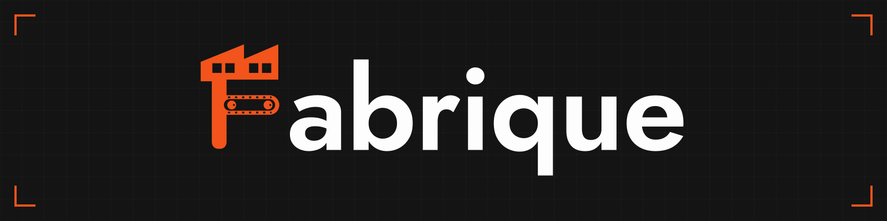
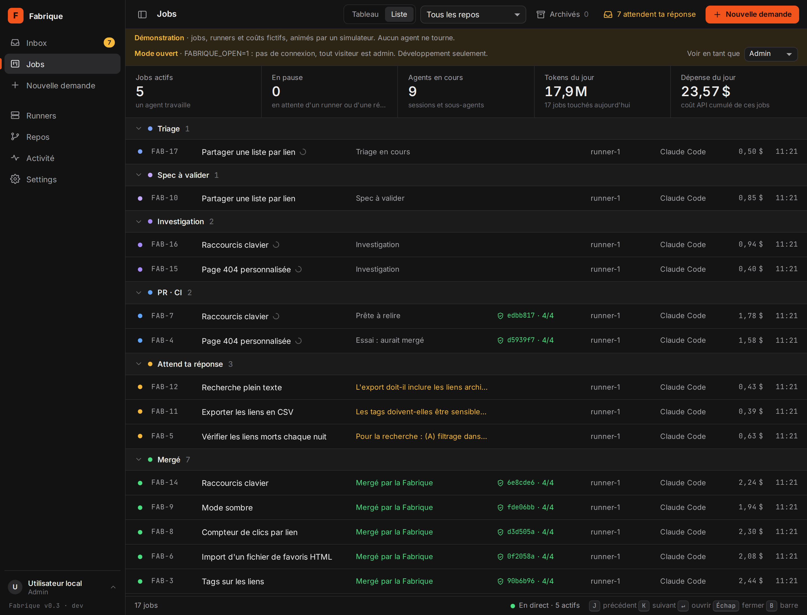
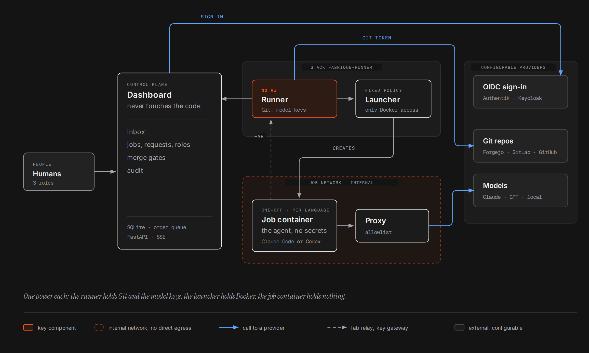
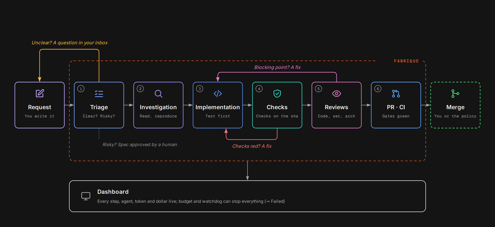
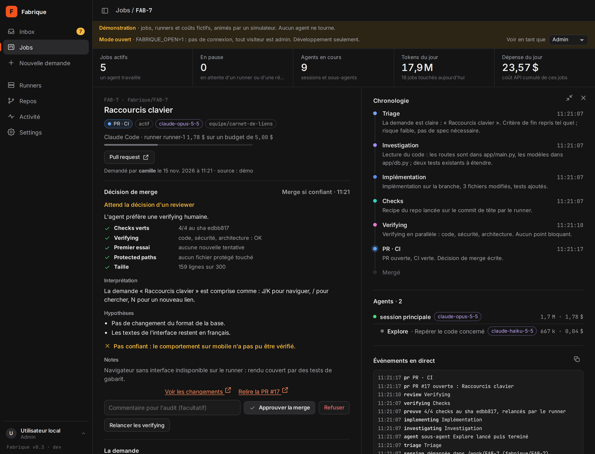
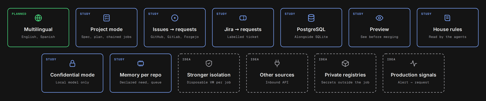

# Fabrique

**English** · [Français](README.fr.md)

**An agentic software factory built for operations.** You file a request; a coding agent triages it, investigates,
implements it and proposes a pull request; a runner with no AI in it replays the checks, has the change reviewed and
applies gates; a human answers questions and decides on merges.

Fabrique is not tied to any provider: Forgejo, GitLab or GitHub for the code; any OIDC provider (Authentik,
Keycloak…) for sign-in; Claude Code or Codex as the agent; an Anthropic, OpenAI or local model (llama.cpp, vLLM).

> The interface is in French for now. English is on its way (see the [roadmap](ROADMAP.md)); until then, this
> documentation quotes interface labels as they appear on screen.



## Why

Getting an agent to write code is easy. Letting it work **unattended** on real repos is not: you need to know what it
is allowed to touch, prove that its tests really pass, cap what it spends, and keep the merge decision in someone's
hands. Fabrique treats these as architecture and infrastructure questions, not as instructions given to the model.

- **The agent holds no secret.** It runs in a disposable container, with no Git token and no model key, on an internal
  network whose only way out is an allowlisted proxy.
- **Evidence does not come from the agent.** The runner itself replays the repo's recipe (install, tests) on the exact
  commit of the PR, then has the diff reviewed by read-only reviewers.
- **Merging is a decision.** Verifiable gates (green checks, review, protected paths, size, first attempt, the agent's
  own opinion) feed a per-repo policy: never on its own, trial mode, or on its own when every gate holds.
- **Everything is traced.** Every step, cost, question, decision and merge is in the audit log.

## How it works



| Part | Role | What it holds |
|---|---|---|
| **Dashboard** (`app/`) | Control plane: requests, inbox, gates, settings, audit. Never touches the code. | The database, the decisions |
| **Runner** (`runner/`) | A program with no AI: takes orders from the dashboard, prepares the workspace, starts the agent, replays the checks, pushes, opens the PR, merges. | Git tokens, model keys (for the duration of a job) |
| **Launcher** (`lanceur/`) | Creates one disposable container per job, with a fixed policy. | The only access to Docker |
| **Job container** | Where the agent and the repo's code run. | Nothing |
| **Proxy** (`proxy/`) | The jobs' only network exit, allowlisted. | — |

The path of a request, from its repo to the merge:



## What Fabrique does

- **Requests and tracking**: request form, board or list of jobs, timeline, live events, cost and tokens per job, inbox
  (questions from the agent, PRs to review, failures, repos to create).
- **Studies**: a request of type « Étude » (study) has the agent read the repo and return a report (analysis,
  estimate, options) without changing anything — no branch, no PR; the report downloads as PDF or Markdown and can
  then become a code request.
- **Repo onboarding**: an agent reads the repo and writes its *recipe* (`.fabrique/setup.json`: image, install,
  checks); the runner replays it in a fresh container; a human merges it.
- **Review**: code and security always, architecture and infrastructure depending on the files touched. A blocking
  finding must come with evidence that the runner replays.
- **Diff in place**: the reviewer reads the diff of the verified commit in the job itself, file by file, with
  protected paths labelled. The runner sends it; the dashboard still never touches the code.
- **Security check on write**: every time the agent writes a file, a search for hard-coded secrets (Betterleaks) and
  for packages that do not exist or were only just published (a name made up by the model). The agent fixes it on the
  spot; a report covering the whole job is added to the evidence, for information.
- **Per-repo merge policies**, protected paths, maximum size, budget per job and per day, watchdog.
- **Repo creation** on human approval, in the organisation chosen for each Git provider.
- **Roles**: requester, reviewer, admin; OIDC sign-in.
- **Notifications**: signed webhook, Microsoft Teams, Jira, e-mail (SMTP).
- **Several runners**, with tags, and job images per language (Python, Node.js, Go, Java).



## Getting started

### Quick start

Download the compose file, then start it: images are pulled from `ghcr.io/lepikouze` (tag `latest`).

```sh
curl -fsSLO https://raw.githubusercontent.com/lepikouze/fabrique/main/deploy/compose.prod.yaml
docker compose -f compose.prod.yaml up -d
docker compose -f compose.prod.yaml logs dashboard | grep "code d'installation"
```

Open `http://<host-address>:8080`, enter the **setup code** printed in the logs (the log line reads « code
d'installation »), then create the administrator account. The **Setup** page walks you through the rest, entirely in
the interface: a model, a Git provider, a first repo. The built-in runner registers itself.

No variable is required. In production, put port 8080 behind a TLS reverse proxy and create a `.env` file next to the
compose file with the public address and the two secrets:

```sh
cat > .env <<EOF
PUBLIC_URL=https://fabrique.example.org
SESSION_SECRET=$(openssl rand -hex 32)
FABRIQUE_SECRET_KEY=$(openssl rand -hex 32)
EOF
```

Job workspaces live in a folder on the host, `/opt/fabrique/travail` by default: Docker creates it on first start,
there is nothing to prepare. To put it elsewhere (a larger disk, for instance), add
`FABRIQUE_WORK_DIR=/path/of/your/choice` to the `.env` file.

`SESSION_SECRET` signs sessions. `FABRIQUE_SECRET_KEY` encrypts the model keys and Git tokens stored in the dashboard:
keep it somewhere safe, because without it those secrets are unreadable and have to be entered again. Without this
file, both are generated on first start and kept with the data.

### Behind Traefik

[`deploy/compose.traefik.yaml`](deploy/compose.traefik.yaml) publishes no port: only Traefik reaches the dashboard.

```sh
curl -fsSLO https://raw.githubusercontent.com/lepikouze/fabrique/main/deploy/compose.traefik.yaml
cat > .env <<EOF
FABRIQUE_HOST=fabrique.example.org
TRAEFIK_NETWORK=traefik
TRAEFIK_CERTRESOLVER=letsencrypt
SESSION_SECRET=$(openssl rand -hex 32)
FABRIQUE_SECRET_KEY=$(openssl rand -hex 32)
EOF
docker compose -f compose.traefik.yaml up -d
docker compose -f compose.traefik.yaml logs dashboard | grep "code d'installation"
```

`FABRIQUE_HOST` is the dashboard's domain name, `TRAEFIK_NETWORK` the Docker network of your Traefik and
`TRAEFIK_CERTRESOLVER` its certificate resolver. Optional: `TRAEFIK_ENTRYPOINT` (default `websecure`).

### On Kubernetes

A Helm chart installs Fabrique in a namespace, with one disposable Pod per job: see
[docs/kubernetes.md](docs/kubernetes.md).

### From source

To change the code or build your own images:

```sh
git clone https://github.com/lepikouze/fabrique.git && cd fabrique
docker compose --profile images build
docker compose up -d
docker compose logs dashboard | grep "code d'installation"
```

[`.env.example`](.env.example) lists the useful variables. To split the dashboard and the runners across several
machines, see [docs/installation.md](docs/installation.md) and the examples in [`deploy/`](deploy/).

### Just a look at the interface

Without Docker, with fictitious data:

```sh
python3 -m venv .venv && .venv/bin/pip install -r app/requirements.txt
FABRIQUE_DATA=./data FABRIQUE_DEMO=1 FABRIQUE_OPEN=1 .venv/bin/uvicorn app.main:app --port 8080
```

`FABRIQUE_OPEN=1` removes sign-in: never expose it.

## Documentation

| Document | Contents |
|---|---|
| [Installation](docs/installation.md) | Deploying the dashboard and a runner, wiring up sign-in, repos and models |
| [Kubernetes](docs/kubernetes.md) | Installing with the Helm chart: one Pod per job, rights in the cluster, storage, limits |
| [How it works](docs/how-it-works.md) | Life cycle of a job, recipe, onboarding, review, gates, notifications |
| [Configuration](docs/configuration.md) | Every environment variable, per component |
| [Security](docs/security.md) | Trust model, isolation, accepted risks, audit results |
| [Development](docs/development.md) | Code layout, tests, migrations, continuous integration |
| [Changelog](CHANGELOG.md) | What was added or changed, version by version |
| [Roadmap](ROADMAP.md) | What comes next, with its status: planned, under study, idea |

## Project status

Fabrique runs in production on a small infrastructure (one Docker host, Forgejo, a local model and remote models). The
Forgejo, GitLab and GitHub connectors, the Claude Code and Codex agents and the four job images have been validated
end to end. A security audit was carried out and its findings fixed (see [docs/security.md](docs/security.md)).

## Roadmap



The details of each item are in [ROADMAP.md](ROADMAP.md). What ships moves to the [changelog](CHANGELOG.md).

## Acknowledgements

Thanks to Jan Marshal: the instructions given to the agents are inspired by his project [marshal-factory](https://github.com/ski043/marshal-factory).

## Fonts

Inter, JetBrains Mono and Jost (the application name), under the SIL OFL 1.1 licence (`app/static/fonts/`).

## Licence

[MIT with the Commons Clause](LICENSE). You may use, modify and share Fabrique freely, including
inside a company. You may not sell it: no paid product, hosted service or paid support whose value comes mainly from
Fabrique. For anything else, ask.
