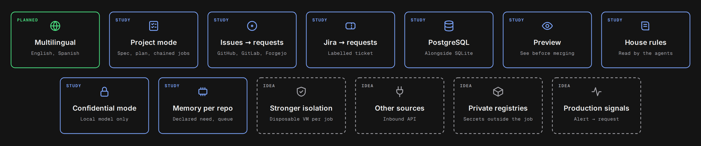

# Roadmap

What comes next in Fabrique. No date and no promised version: only a status.

- **Planned**: decided, coming in a future version.
- **Under study**: likely, the shape is still open.
- **Idea**: up for discussion, may never happen.

What ships leaves this page and moves to the [changelog](CHANGELOG.md).

## Planned

### Multilingual
The interface and its messages are in French today; the documentation is now in English. English and Spanish are
coming for the interface, with a language choice per account; other languages later, as needed.

`English` `Spanish` `Per-account choice` `Documentation`

## Under study

### Project mode
Build a whole application from one request. A request of type "Project" has the agent write a specification, a
technical plan and an ordered list of tasks into the repo (`specs/`), in the spirit of spec-driven development. A human
approves that pull request; Fabrique then creates one request per task and runs them in order, each job reading the
spec and the plan first. A project page shows progress, and a budget caps the whole project.

`Specification` `Plan` `Task list` `Chained jobs` `Human approval`

### Requests from an issue
A `fabrique` label on a GitHub, GitLab or Forgejo issue creates an incoming request in the inbox. Nothing starts
without a reviewer's approval. Fabrique then comments on the issue: job created, PR opened, merge.

`GitHub` `GitLab` `Forgejo` `Label` `Human approval`

### Requests from Jira
Same principle, starting from a labelled Jira ticket. The repo is chosen at approval time.

`Jira Cloud` `Jira Data Center` `JQL`

### PostgreSQL
PostgreSQL in addition to SQLite, for larger installations or several dashboard replicas.

`PostgreSQL` `SQLite` `Migrations`

### Preview
See a change running before deciding on the merge.

`Ephemeral environment` `Before the merge`

### House rules
A rules file specific to each repo (conventions, things not to do, architecture choices), read by the agents and by
the reviewers.

`Conventions` `Reviews` `Per repo`

### Confidential mode
A request marked confidential only goes through a local model: nothing leaves for a remote provider.

`Local model` `Sensitive data`

### Memory per repo and queue
Today every job has the same ceiling (4 GB) and the only safeguard is the number of jobs running in parallel. A repo
with end-to-end tests in a browser does not have the needs of a small service.

- **Requirement declared per repo** in its recipe (for example 8 GB for E2E tests, 1 GB for a small service), capped
  by a maximum set by the admin.
- **Queue with a memory budget**: a job only starts if the sum of the requirements of the running jobs fits in the
  runner's memory, minus a margin; otherwise it waits instead of bringing the others down.
- **Peak measured for every job**, shown in the job, to tune the repo's requirement to reality. A job killed for lack
  of memory is reported as such, and can be restarted once with a higher ceiling if the budget allows.

`Memory` `Admission` `Queue` `OOM` `E2E tests`

## Ideas

### Stronger isolation
Each job in a disposable virtual machine, on top of the container or the Pod.

`Disposable VM` `Isolation`

### Other sources of requests
A small API with a token so that other tools can file requests, which go through the same approval.

`API` `Token` `Human approval`

### Private package registries
A repo that depends on internal packages (PyPI, npm, Maven or company Go modules) cannot be installed in a job
without a credential, and no secret enters the container. As with model keys, a relay in the runner would add the
credential and forward to the registry: the job would never see the secret.

`Private PyPI` `Private npm` `Maven` `Credentials outside the job`

### Production signals
A monitoring alert that proposes a fix request, to be approved like any other.

`Monitoring` `Alerts` `Human approval`
