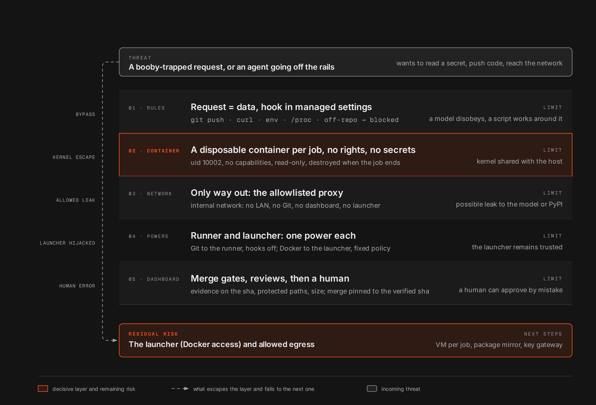

# Security

## Trust model

The model is that of CI runners: a **trusted manager** (the runner) and **untrusted executions** (the repos' code and
the agent). An agent reads content nobody controls — files in the repo, the text of requests — and can therefore be
hijacked. Fabrique assumes that **anything running in a job may be hostile**, and gives each part a single power.

| Part | What it holds | What it cannot do |
|---|---|---|
| **Dashboard** | the database, the decisions, the audit | touch the code or the repos |
| **Runner** | the dashboard token, Git tokens, model keys for the duration of a job | talk to Docker; execute a repo's code |
| **Launcher** | the only access to Docker | anything other than create, exec into and stop **its own** job containers, with a fixed policy |
| **Job container** | this job's workspace | read a secret; reach the Git host, the dashboard, the launcher, the local network or the Internet outside the allowlist |

## A job's container

The policy is imposed by the launcher and the runner cannot negotiate it: image chosen from an allowlist, unprivileged
user (uid 10002), no capability, `no-new-privileges`, read-only file system (except the work space and `/tmp`),
limited memory, CPU and number of processes, a single mount (**this** job's workspace), a single network. The launcher
refuses to act on a container it did not create.

The jobs' network is internal, with no gateway. Its only exits:

- the allowlisted **proxy**, for package registries;
- the runner's **`fab` relay**, with a token specific to the job, to talk to the dashboard;
- the runner's **key gateway**, with that same token, to talk to the model. It replaces the token with the real key
  and only opens the agents' endpoints: exact path, `POST` only (no sub-resource, no `..`). It measures the cost of
  every call, at any point in the job (agent, checks, reviewers), reports it to the dashboard and caps it at the job's
  budget: a call in progress is reserved before being relayed, and a paid response with no usage counter is estimated,
  never counted as zero. Local models go through it too: the model's machine is not reachable by jobs.

No credential of the runner enters a job: no model key, no Git token, no subscription token. An Anthropic model with
no API key (in the dashboard or on the runner) makes the job fail before the agent starts.

## The workspace is never trusted

The agent writes the whole workspace, `.git` folder included. So the runner never trusts it.

- **Git token.** It is only used in a Git mirror owned by the runner, which the agent can read but not write and
  which is never mounted in a job. The main branch is copied there from the Git host; the agent's commit is imported
  into it (objects verified), checked, then pushed from there. The agent clones from this mirror, with no token.
- **Git on the runner side.** In its own container, the runner only runs git on what it created itself: its mirror,
  and the initial clone of the workspace, before any agent has touched it (system binary and `PATH`, configuration
  imposed through the environment). Once the agent has been there, its repository is configured by it — a content
  filter or a signing program declared in `.git/config` would be run by git, and no list of frozen settings can name
  them all. Operations on that repository (status, add, commit, bundle of the commits) therefore run in the job's
  container, where the agent's code already runs. Nothing they print is taken as authoritative.
- **Importing the commit.** The commit bundle written on the job side is read only as data: opened without following
  links, refused if it is not a regular file, copied to a folder of the runner, then imported from that copy.
- **Recipe and diff base.** Read from the mirror, at the Git host's commit. The list of changed files and their size
  are computed in the mirror, on raw paths; the dashboard treats any doubtful path as protected.
- **Onboarding.** The commit must contain the recipe and nothing else; the recipe replayed is the one in the commit;
  if the replay changes the commit, the onboarding fails.
- **Agent's text.** Bounded and made inert before being published with the bot account (PR, comments) or sent in a
  notification: no mention, issue-closing keyword, image or link (direct, by reference, bare address, HTML entity).
- **List of files in a PR.** If the dashboard cannot faithfully compare a path with the protected paths — more than
  500 files, a path of 300 characters or more, a control character — the gate counts the file as protected: a human
  decides.
- **Reviewers.** The job's processes are stopped before the review. An "ok" returned on a truncated diff does not
  count: the review is marked incomplete. In agent mode, the reviewer is started by its absolute path, with the system
  `PATH`, a fresh home folder and an export of the verified commit taken from the runner's mirror: neither the working
  tree nor the home folder that the agent and the checks may have modified.

## Instructions are not gates

The instructions given to the agent, and the hook that filters its commands in Claude Code (`runner/garde.py`), reduce
mistakes; they are not security boundaries. The boundaries are the container, the network, the absence of secrets and
the verifications done by the runner and the dashboard.

## Sign-in and secrets

- First start: creating the administrator account requires a setup code written to the container's logs. Strong
  passwords, hashed (scrypt), five attempts per quarter of an hour.
- OIDC with PKCE; identity token verified; signed sessions. An incomplete configuration closes the dashboard (503),
  except for the local fallback account. An OIDC sign-in cannot take over the name of a local account.
- Model keys, Git tokens, the OIDC secret and channel secrets are encrypted in the database (`FABRIQUE_SECRET_KEY`),
  write-only. Git tokens and model keys are handed to the runner for each job.
- **A secret does not follow a change of destination.** Changing the address of a model provider, a Git provider, a
  Jira or an SMTP server requires entering the key, token or password again: a stored secret is never sent to an
  address it was not entered for.
- Runner tokens are only kept as a hash. « Renouveler le token » issues a new one without recreating the runner (the
  old one stops working at once); « Révoquer » cuts access immediately.
- **Revocable sessions.** Signing out, changing your password or an admin's « Déconnecter » button (Settings →
  Utilisateurs) closes all the account's open sessions, server-side: a copied session cookie is worth nothing. Removing
  someone's role removes all their access from the next request.
- Requests that change state are refused if they come from another origin.
- **Generated secrets.** `SESSION_SECRET` and `FABRIQUE_SECRET_KEY`, if they do not come from the environment, are
  generated in `secrets.json` (atomic write). If that file is damaged or the folder not writable, the dashboard
  refuses to start: it never runs with an empty secret. A session secret that is too short also closes local accounts.
- **Token files (all-in-one).** The launcher's token is `0600`; the built-in runner's is `0640`, readable by a group
  that the runner receives (`group_add`) and that the agent's user does not have. The runner warns at start-up if a
  token file is world-readable.

## Accepted risks

- **The launcher has access to Docker.** If compromised, it would compromise the host. It is tiny, only listens on a
  private network shared with the runner alone, requires a token and refuses anything outside its policy. Possible
  hardening: launcher and jobs on a dedicated machine, rootless Docker.
- **Shared kernel.** A container is not a VM. For untrusted code, aim for a disposable VM per job (on the roadmap).
- **Leak through allowed exits.** An agent can in theory get code out through a request to the model or to a package
  registry. Reduce the allowlist, or use an internal package mirror.
- **OIDC identity.** Accounts are recognised by their user name (or their e-mail). If the provider lets users change
  these fields themselves, restrict that right on the provider side.
- **Generated secrets.** Without variables, the encryption key is kept with the data: provide `SESSION_SECRET` and
  `FABRIQUE_SECRET_KEY` through the environment to separate them.
- **Open mode.** `FABRIQUE_OPEN=1` removes sign-in: for development only.
- **`local` execution mode.** The agent runs in the runner's container, separated by a plain Unix user: for
  development and demonstration only.

## Audit

The code has been through two full security audits (code reading, search by area, each finding reproduced in a
sandbox with no network then verified independently), the second rechecking every fix from the first. Confirmed
findings were fixed, and each is covered by a regression test (`tests/test_audit.py`, `tests/test_audit3.py`). The
principles above — runner's mirror, agent's git run on the job side, capped gateway, reviewer independent of the job,
inert agent text — come directly from them.

What remains to be checked in each installation, because the code cannot decide it:

- **OIDC identity.** An account is tied to the user name (`preferred_username`), otherwise to the e-mail. The identity
  provider must not let a user choose or change these values, nor reassign a name.
- **Version tags.** The Forgejo workflow publishes images for any `v*` tag: creating these tags must be reserved for
  maintainers (protected tags), and images deployed by digest rather than by tag.
- **Exposure.** The all-in-one compose publishes the dashboard over HTTP on all interfaces: behind a TLS reverse
  proxy, restrict the published port to that proxy.

## Reporting a vulnerability

Write to the repo's maintainer, privately, with enough to reproduce the problem.
